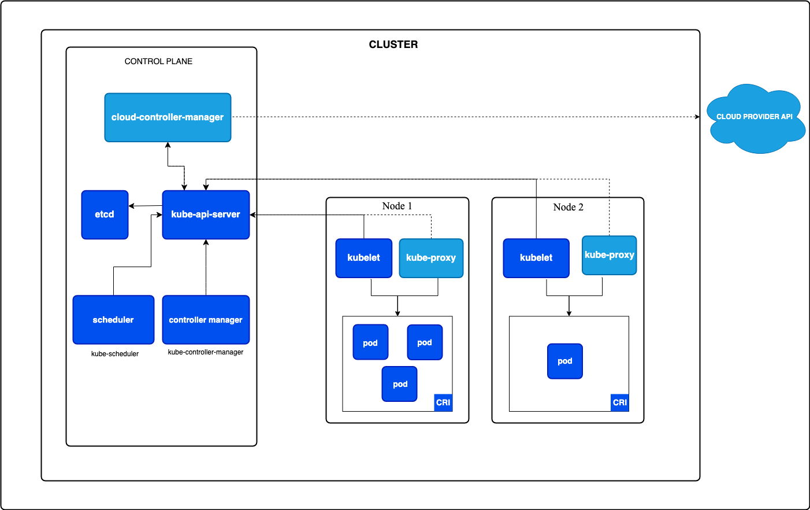

1. Install Minikube (or enable Kubernetes in Docker Desktop).

2. Start the cluster: ```minikube start```

3. Verify: ```kubectl get nodes```


## Pod
> Pods are the smallest deployable units of computing that you can create and manage in Kubernetes. A Pod is not a process, but an environment for running container(s). A Pod is temporary.

4. Create the ```nginx-pod.yaml``` file above.

5. Run:
```bash
kubectl apply -f nginx-pod.yaml
kubectl get pods
kubectl describe pod nginx
kubectl logs nginx
kubectl exec -it nginx -- sh
kubectl delete pod nginx
```


## Deployment Architecture
Each layer has a responsibility:

```bash 
Deployment → manages application updates and scaling.
ReplicaSet → ensures the correct number of pods are running.
Pod → runs one or more containers.
Container → your application.
```

#### Question: Why did Kubernetes create a new pod this time, but not in Lesson 1?

> Answer: Because the Deployment declared that there should always be three replicas. The Deployment (through its ReplicaSet) noticed the count dropped and created a replacement.

### Compare Pods and Deployments

| Pod                                 | Deployment                     |
| ----------------------------------- | ------------------------------ |
| Runs a container                    | Manages Pods                   |
| Temporary                           | Self-healing                   |
| No automatic restart after deletion | Recreates failed Pods          |
| Manual scaling                      | Easy scaling                   |
| Rarely used directly                | Standard for most applications |


## Services
A Service gives your pods a stable virtual IP and DNS name.
#### How Does the Service Know Which Pods to Send Traffic To?
> Labels are how Kubernetes connects resources together.





#### Types of Services
Types of Services

There are four main Service types.

1. ClusterIP (Default)
```bash
Inside Cluster
     │
Frontend
     │
Backend
```

Accessible only inside the cluster.

Most internal microservices use this.

2. NodePort
```bash
Browser
    │
NodeIP:30080
    │
Service
    │
Pods
```

Exposes the Service on a port of every node (typically in the 30000–32767 range).

Useful for learning, not commonly used directly in production.

3. LoadBalancer
```bash
Internet
    │
Cloud Load Balancer
    │
Service
    │
Pods
```

Cloud providers (AWS, Azure, GCP) create an external load balancer for you.

This is a common production choice.

4. ExternalName

> Maps a Kubernetes Service name to an external DNS name.

Example:

database.company.com

No pods are involved.

#### Pods vs Services
Pod	Service
| Pod                       | Service                                  |
| ------------------------- | ---------------------------------------- |
| Runs your application     | Provides a stable endpoint               |
| Has a changing IP         | Has a stable virtual IP and DNS name     |
| Can crash or be recreated | Remains available                        |
| Doesn't load balance      | Distributes traffic across matching pods |


## Configmap and Secrets

> ConfigMap stores Configuration: API URLs, feature flags, ports

> Secret stores Sensitive data: Passwords, API keys, tokens


## Volumes

A Volume is storage attached to a pod.
The Real Solution: PersistentVolume (PV)

PV and PVC (PersistentVolumeClaim)
Think of it as house and rental agreement

```bash

 PersistentVolume (PV) :Actual storage available in the cluster

PersistentVolumeClaim (PVC) : Request for storage by an application
            |
Pod

```

> A pod never directly uses a PV. It uses a PVC.


## Namespaces, Labels & Selectors

### Namespaces
> Think of a namespace as a virtual cluster inside a cluster.
> The same resource name can exist in different namespaces.

### Labels
> Labels are key-value tags attached to resources.
> Think of labels as searchable metadata.

#### This is one of the most common Kubernetes bugs. Labels dont match or namespace diff
#### Labels can be same in diff namespace

### Selectors
> Selectors are how Kubernetes finds resources.


#### Important Rule
```

⚠️ Never change a Deployment’s selector after creation.

```

Kubernetes may lose track of its pods.

## Rolling Updates, Rollbacks & Health Checks

### Rolling Updates
Kubernetes updates pods gradually.
#### What Actually Happened?
Kubernetes created a new ReplicaSet.
During the rollout, both ReplicaSets temporarily coexist.

See them: ```kubectl get rs```

#### Undo a deployment if rollback fails
```kubectl rollout undo deployment/web```


```FeatureLiveness ``` : if the container is running and healthy.

```ProbeReadiness``` : Determines if the container can accept incoming network traffic.


#### Interview Questions

Q How does Kubernetes achieve zero downtime?

> Rolling updates + readiness probes + Services routing only to Ready pods.

Q What is maxUnavailable?

> Maximum number of pods that can be unavailable during an update.

Q What is maxSurge?

> Maximum extra pods created temporarily during an update.

Q How do you rollback a deployment?

> kubectl rollout undo deployment/<name>